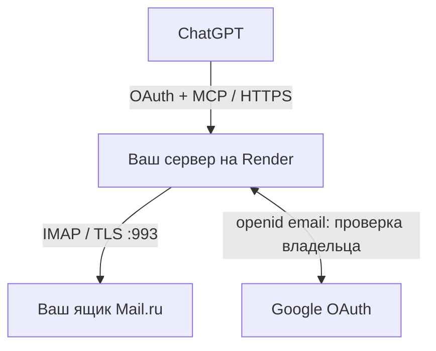

# Mail.ru MCP starter — почта в ChatGPT

Персональный MCP-сервер на Python: подключает один ящик Mail.ru к ChatGPT через Google OAuth и работает с почтой по IMAP. Развёртывается на собственном сервисе Render; у каждого пользователя — свои учётные данные и свой сервер.

**Главный шаг: создайте специальный пароль для внешнего приложения Mail.ru. Обычный пароль от ящика не работает.** Выберите **«Полный доступ к Почте»** и сохраните полученный пароль только в `MAILRU_APP_PASSWORD` в Environment своего сервиса. [Официальная инструкция Mail.ru](https://help.mail.ru/mail/login/mailer/).

## Что умеет

| Команда | Действие |
|---|---|
| `mail_list_folders` | Папки и возможности IMAP-сервера |
| `mail_search` | Поиск по отправителю, теме, дате и непрочитанным; до 30 заголовков |
| `mail_read` | Чтение без отметки «прочитано» |
| `mail_move` | Перемещение одного выбранного письма в существующую папку |
| `mail_delete` | Перемещение одного выбранного письма в системную корзину |

Отправки, очистки корзины и безвозвратного удаления нет. Для восстановления используйте `mail_move` из корзины обратно в нужную папку. При чтении используются `EXAMINE`/`BODY.PEEK`, при перемещении — `UID MOVE`; общий `EXPUNGE` не вызывается.

## Как повторить

1. Сделайте Fork этого репозитория.
2. Разрешите IMAP и создайте пароль внешнего приложения в Mail.ru.
3. Разверните Python Web Service на Render Free из своего Fork.
4. Создайте Google OAuth Client типа Web application с callback вашего сервиса.
5. Заполните секреты и разрешённый Google-аккаунт в Render Environment.
6. В ChatGPT → Plugins → «+» → Add custom MCP server добавьте `https://YOUR-SERVICE.onrender.com/mcp`, выберите OAuth/DCR и scope **`mail.access`**.
7. Войдите через Google и подтвердите перечисленные операции. Проверьте поиск, чтение, перемещение в корзину и восстановление на специально подготовленном письме.

**Пошаговая инструкция:** [docs/SETUP_RU.md](docs/SETUP_RU.md). В ней есть точные переменные, команды, контрольные результаты и разбор ошибок.

## Схема



Google используется для входа в MCP, а не для доступа к Gmail. Ящик Mail.ru может иметь другой адрес. Запросы чтения передают выбранные заголовки и тексты писем в ChatGPT; сервер обрабатывает их в памяти. Картинки и ссылки из писем не загружаются.

## Права без сюрпризов

Все пять команд используют **один scope `mail.access`**. Страница согласия заранее перечисляет чтение, перемещение и удаление в корзину. Это собственный scope данного сервера, а не разрешение Google или Mail.ru. Автоматического повышения старых read-only токенов в публичном шаблоне нет.

Разрешён только подтверждённый Google email из `ALLOWED_GOOGLE_EMAIL`. Токены проверяются по подписи, issuer, audience, сроку и scope. Письма — недоверенные данные: их текст не является поручением пользователю или агенту. Подробнее: [SECURITY.md](SECURITY.md).

## Переменные

| Имя | Где получить / назначение |
|---|---|
| `MAILRU_USER` | Полный адрес своего ящика |
| `MAILRU_APP_PASSWORD` | **Пароль внешнего приложения**, не основной пароль |
| `MCP_ACCESS_TOKEN` | Случайный секрет от 32 символов; Blueprint генерирует его |
| `GOOGLE_CLIENT_ID` | Google OAuth Client вашего проекта |
| `GOOGLE_CLIENT_SECRET` | Секрет того же Google OAuth Client |
| `ALLOWED_GOOGLE_EMAIL` | Google email, которому вы разрешаете доступ |
| `PUBLIC_BASE_URL` | Необязательно: HTTPS origin своего домена/туннеля. На Render определяется автоматически |
| `ALLOWED_GOOGLE_SUB` | Необязательно: дополнительная фиксация Google subject |

Незаполненный пример: [.env.example](.env.example). Настоящие значения не добавляйте в Git, issue, скриншот или чат.

## Тесты

```bash
python -m venv .venv
# Linux / macOS:
source .venv/bin/activate
# Windows PowerShell: .venv\Scripts\Activate.ps1
python -m pip install -r requirements-dev.txt
python -m pytest tests -q
python scripts/check_public.py
```

В публичной адаптации локально пройдены **47 тестов**: авторизация, PKCE, callbacks, scope, UIDVALIDITY, IMAP-инъекции, MOVE, корзина и обрыв соединения. Тесты используют подмену IMAP и Google, не читают и не изменяют настоящий ящик. CI повторяет их при push/PR.

## Что уже проверено и где границы

Исходная персональная интеграция проверена на реальном Mail.ru: поиск, чтение, перемещение выбранного письма в корзину с проверкой обеих папок. Этот публичный вариант очищен от персональных настроек и имеет другую, единую модель scope. Новое развёртывание из Fork требует собственной проверки по инструкции; 47 тестов не подменяют живую проверку Google/ChatGPT/Mail.ru.

Render Free засыпает после 15 минут простоя, пробуждение занимает около минуты. Данные на локальном диске сервиса не сохраняются. Здесь нет постоянной БД: незавершённую OAuth-сессию после перезапуска нужно начать заново. Это пример для одного владельца, не готовый многопользовательский почтовый сервис. [Ограничения Render](https://render.com/docs/free).

## Файлы и лицензия

`server.py` — MCP и защита endpoint; `mailbox_client.py` — IMAP; `oauth.py` — персональный OAuth-сервер; `render.yaml` — Blueprint; `docs/` — инструкция и разбор опыта; `tests/` — проверки.

Сохранена выбранная владельцем лицензия репозитория [MPL-2.0](LICENSE). Перенесённые и адаптированные файлы исходной реализации (`server.py`, `oauth.py`, `mailbox_client.py`, `tests/`, `requirements.txt`, `render.yaml`, `.gitignore`) сохраняют Apache-2.0; её текст — [LICENSE-APACHE-2.0](LICENSE-APACHE-2.0). Новые инструкции, примеры, CI и скрипт проверки относятся к MPL-2.0. Подробности — [NOTICE](NOTICE). Независимый пример, не официальный продукт Mail.ru, Google, OpenAI или Render.
